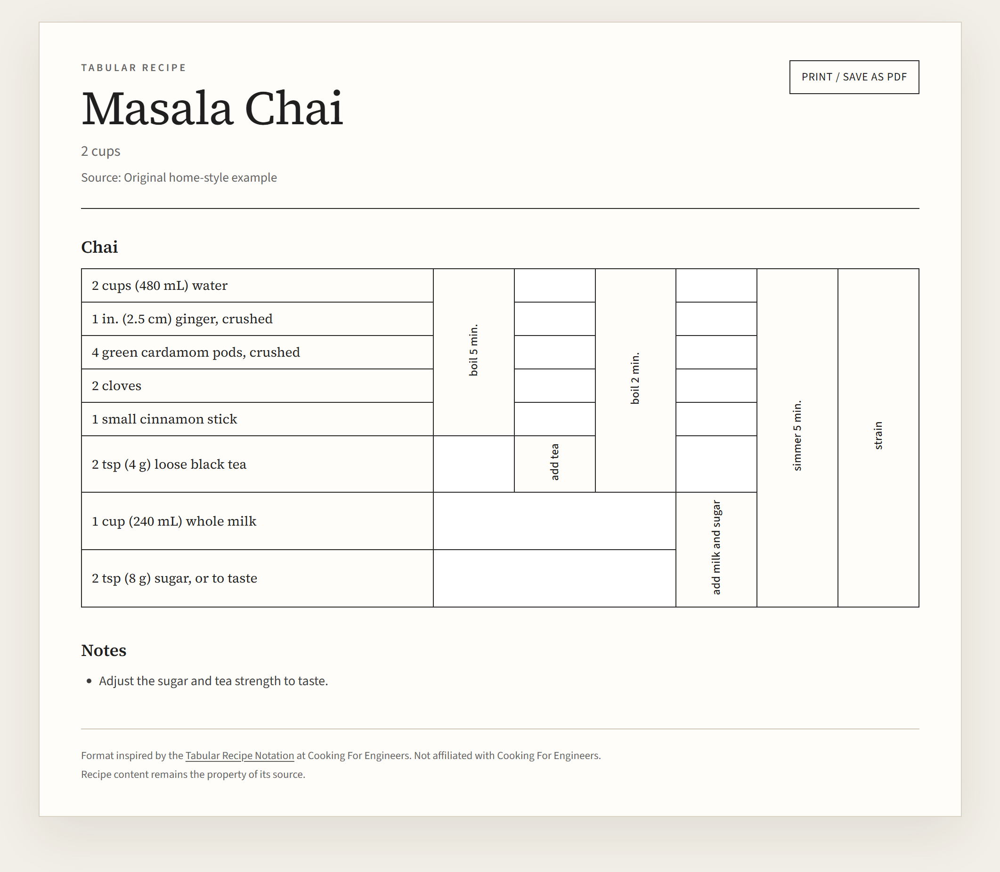

# Tabular Recipe

Turn a recipe into a **tabular recipe card**: every ingredient is a row, every action is a column, and each action cell spans exactly the rows it acts on. The output is a self-contained HTML file that prints cleanly and can be saved as PDF from the browser.

This is an [Agent Skill](https://opencode.ai/docs/skills/) for OpenCode. The agent models the recipe; a zero-dependency Node script validates the model and renders the table geometry.



*Masala Chai: eight ingredients, six action columns, one printed page. The ingredients are rows; each vertical action column spans exactly the rows it works on.*

## What is in the repo

```text
tabular-recipe/
  README.md
  LICENSE
  docs/
    masala-chai-card.png       README screenshot
  skills/
    tabular-recipe/
      SKILL.md                 Agent workflow, schema, quality gates
      references/
        notation.md            Table semantics and field reference
        modeling.md            How to turn prose into rows and spans
        style-guide.md         Labels, units, Indian ingredient glossary
      scripts/
        render.mjs             Validator + HTML renderer (no dependencies)
      assets/
        fonts/                 Embedded Source Sans 3 / Source Serif 4 (OFL)
      examples/
        masala-chai.json/.html
        aloo-paratha.json/.html
        tandoori-chicken.json/.html
        vegetable-dum-biryani.json/.html
        koyla-butter-chicken.json/.html
```

The example HTML files are generated from the JSON. Open them in a browser to see the format.

## Quick start

Requires Node.js 18 or newer. There are no npm dependencies.

```powershell
# Validate a model without writing anything
node skills/tabular-recipe/scripts/render.mjs skills/tabular-recipe/examples/masala-chai.json --check

# Render next to the JSON (masala-chai.html)
node skills/tabular-recipe/scripts/render.mjs skills/tabular-recipe/examples/masala-chai.json

# Render to a specific path and open it
node skills/tabular-recipe/scripts/render.mjs skills/tabular-recipe/examples/masala-chai.json --out .\masala-chai.html --open
```

Exit code is `0` for a clean validation (warnings allowed), `1` for validation or file errors, and `2` for bad command-line usage. `--check` still reports warnings and exits non-zero on errors.

## Output

- **HTML**: one self-contained file, inline CSS, and embedded WOFF2 fonts. No network requests, images, or scripts.
- **JSON**: the source model, kept beside the HTML so the card can be corrected and re-rendered.
- **Print**: a print button opens the browser dialog. Set paper size to A4 or Letter and margins to default; the stylesheet handles the print layout and page orientation.
- **No Markdown export**: the grid is the artifact; chat gets a short summary.

## Model at a glance

```json
{
  "schema_version": 1,
  "title": "Masala Chai",
  "yield": "2 cups",
  "source": { "name": "Original home-style example" },
  "print": { "orientation": "portrait" },
  "sections": [
    {
      "name": "Chai",
      "setup": [],
      "rows": ["1 cup (240 mL) water", "1 tsp (2 g) loose black tea"],
      "actions": [
        { "label": "boil 5 min.", "spans": [[0, 2]] },
        { "label": "strain", "spans": [[0, 2]] }
      ]
    }
  ],
  "layers": null,
  "notes": ["Adjust the sugar to taste."]
}
```

- `rows` are ingredient strings, ordered by first use.
- `actions` are columns, left to right.
- `spans` are zero-based `[startRow, rowCount]` pairs. Every action covers a contiguous block; multiple spans are allowed when the same phase genuinely touches separated groups.
- `setup` holds full-width preheat/grease/soak steps above the grid.
- `layers` is an optional top-to-bottom layer diagram for biryani, lasagna, trifle, and similar dishes.
- `print.orientation` is `portrait` (default) or `landscape` for wide tables.

The renderer computes rowspans/colspans, merges adjacent blank cells, checks the grid row by row, and refuses to render a model with overlapping or out-of-bounds spans.

Read `SKILL.md` and the three reference files before authoring a new model. They cover row ordering, divided ingredients, setup rows, final-action placement, and Indian technique patterns such as tadka, bhuna, pressure cooking, dum, and biryani layering.

## Examples

| Recipe | Sections | Action columns | Print |
|---|---|---|---|
| [Masala Chai](skills/tabular-recipe/examples/masala-chai.html) | 1 | 6 | 1 portrait page |
| [Aloo Paratha](skills/tabular-recipe/examples/aloo-paratha.html) | 3 (dough, filling, assembly) | 4-5 | 1 portrait page |
| [Tandoori Chicken](skills/tabular-recipe/examples/tandoori-chicken.html) | 2 (marinade, roast) | 4 | 1 portrait page, with setup rows |
| [Koyla Butter Chicken](skills/tabular-recipe/examples/koyla-butter-chicken.html) | 3 (marinade, gravy, finish) | 4-8 | 2 portrait pages, with coal-smoke finish |
| [Vegetable Dum Biryani](skills/tabular-recipe/examples/vegetable-dum-biryani.html) | 3 (rice, vegetable layer, assembly) | 9 | 2 landscape pages, with layer diagram |

Masala Chai, Aloo Paratha, Tandoori Chicken, and Vegetable Dum Biryani are original home-style models, not authoritative published versions. Koyla Butter Chicken is adapted from the linked Sanjeev Kapoor Khazana video and the published ingredient list; the card names its source and records the differences in its notes.

## Install as an OpenCode project skill

The skill must live at `.opencode/skills/tabular-recipe/SKILL.md`. On Windows, junction the repo's skill directory into an OpenCode project:

```powershell
New-Item -ItemType Junction `
  -Path "C:\path\to\project\.opencode\skills\tabular-recipe" `
  -Target "C:\path\to\tabular-recipe\skills\tabular-recipe"
```

On macOS or Linux, use a symlink:

```bash
ln -s /path/to/tabular-recipe/skills/tabular-recipe /path/to/project/.opencode/skills/tabular-recipe
```

The directory name and the `name` field in `SKILL.md` must both be `tabular-recipe` (lowercase, hyphenated).

## Use it

In an OpenCode session, ask for a tabular recipe and provide the source:

- “Make a tabular recipe card for this chana masala recipe: …”
- “Convert this recipe URL to the Cooking For Engineers table format.”
- “Turn this photo of my grandmother's biryani recipe into a printable card.”

The agent reads the skill, writes `recipes/<slug>.json`, runs `--check`, fixes any errors, renders `recipes/<slug>.html`, and inspects the result. It preserves the source's quantities, splits divided ingredients into separate rows, and records assumptions in `notes`.

## Attribution

The tabular format is inspired by the **Tabular Recipe Notation** popularized by Michael Chu at [Cooking For Engineers](https://www.cookingforengineers.com/). This project is not affiliated with or endorsed by Cooking For Engineers. The HTML/CSS is original; no site assets are copied. Recipe content remains the property of its source.

Bundled **Source Sans 3** and **Source Serif 4** fonts are licensed under the SIL Open Font License 1.1. License texts are in `skills/tabular-recipe/assets/fonts/`.

## License

The skill code and documentation are released under the **MIT License**. See [LICENSE](LICENSE).

The MIT license does not cover the bundled fonts, which remain under the SIL Open Font License 1.1, or the recipe text, which remains the property of its respective source.
